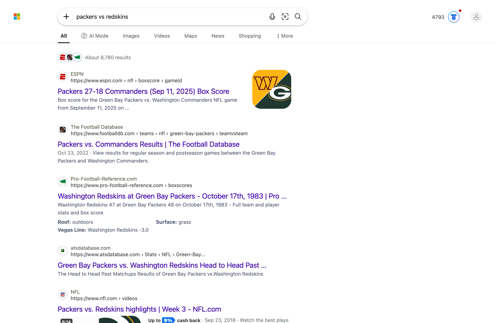

# Bing Rewards — Closed-Loop Collector (Firefox, macOS)

A rewrite of [jack-mil/bing-rewards](https://github.com/jack-mil/bing-rewards)
for Firefox on macOS that **verifies its own work**. The upstream tool types N
searches and hopes for the best (open-loop). This version reads your live
points balance before and after every batch, retries when searches stop
registering, stops early when the day is done, and ends with a clear
SUCCESS / PARTIAL / FAIL verdict.

One command each morning:

```sh
uv run bing-rewards
```

## What "closed-loop" means here

| Stage | Verification |
|---|---|
| Launch | Firefox starts against a **clone** of your logged-in profile — your real profile is never touched |
| Sign-in gate | The Bing account avatar must be present and auth cookies (`WLS`, `_U`, `RPSSecAuth`, …) detected — otherwise the run **stops before wasting a single search** |
| Points before | Live balance read from the rewards medallion (`#rh_rwm`) embedded in Bing pages (base64 JSON, authoritative), with legacy user-status API and DOM fallbacks |
| Per batch | After every `--batch-size` searches (default 5) the balance is re-read; if it didn't move, the batch is retried once with fresh queries and longer delays, then the round is declared stalled and stopped |
| Quota | When the live search-card progress is readable, the round stops at the real daily cap; when it isn't (some markets), fallback targets are used (30 desktop / 10 mobile) |
| Mobile | Second round with a phone user-agent + viewport via `general.useragent.override`; same point-delta verification, honestly reported |
| Idempotency | A JSON log per day (`runs/YYYY-MM-DD.json`) records registered/complete rounds — running twice doesn't redo what worked |
| Report | Points before → after, per-round attempted/registered/wasted, notes, verdict + reasons, exit code (0/1/2) |

Example report:

```
==========================================================
  BING REWARDS RUN REPORT — 2026-10-14  ⚠️  PARTIAL
==========================================================
  points: 4773 -> 4793  (+20)
  desktop : attempted 2, registered 2, wasted 0
    • --max-searches 2 reached
    • live quota unreadable; using fallback target 30
    • using point deltas (search counter unavailable)
----------------------------------------------------------
  reason: registered 2 of 2 attempted searches
  run log: runs/2026-10-14.json
==========================================================
```

## Screenshots (real run, macOS Ventura + Firefox 158)

Browser launched on the cloned profile, before the first search, and after a
verified batch — note the live points counter (4793) in the top-right medallion:

| Launched | Before | After (+20 pts) |
|---|---|---|
|  |  |  |

Screenshots are window-scoped (captured through the WebDriver, not the whole
desktop) so no personal screen content is ever committed.

## Requirements

- macOS (developed/verified on Ventura 13, Intel)
- [Firefox](https://www.mozilla.org) logged into Bing with your Microsoft account
  in the `default-release` profile (override with `--profile <name>`)
- [uv](https://docs.astral.sh/uv/) (or any Python ≥3.10)
- `geckodriver` — resolved automatically by Selenium Manager on first run, or
  install explicitly: `brew install geckodriver` and pass `--geckodriver /usr/local/bin/geckodriver`

## Usage

```sh
uv run bing-rewards                 # full daily collection (desktop + mobile)
uv run bing-rewards -n              # DRY RUN: whole loop against a mock account, burns nothing
uv run bing-rewards --max-searches 3 -d   # small live smoke test, desktop only
uv run bing-rewards --force         # ignore today's run log and redo rounds
```

Useful flags: `--delay 6,12` (randomized inter-search delay), `--batch-size`,
`--mobile-count/--desktop-count` (fallback targets), `--headless`,
`--no-screenshots`, `--runs-dir`, `-v`.

## Why Selenium + geckodriver (not Playwright)

Playwright's Firefox build is a special distribution that cannot attach to
your real user profile, and its `-juggler` mode is not a supported public API.
geckodriver drives the stock Firefox.app and accepts any profile directory, so
we clone `default-release` (cookies included) to a temp dir per run: searches
count toward your account, your daily-use profile is never mutated, and a
corrupted automation session can't break your browsing.

## Design notes & known limits

- **Profile cloning**: cookies are copied, so logins work. If Firefox is
  *running* while a run starts, the clone can lag behind the newest cookies —
  the tool warns and the sign-in gate catches it (stops instead of searching
  against a logged-out session). Best results: quit Firefox before the run.
- **Balance lag**: Bing's displayed balance updates slightly behind reality;
  point *deltas* per batch are what the loop relies on, so this only affects
  the absolute before/after numbers by at most one batch.
- **Per-card progress** comes from the legacy `rewards.bing.com` user-status
  API. Some markets (including the one this was built on) now 404 that portal;
  the collector then verifies via point deltas and uses fallback targets.
- **Mobile UA spoofing** is the standard approach (as upstream) but is
  unofficial; if Bing doesn't credit those searches, the closed loop reports
  the mobile round as stalled rather than pretending success.
- **Quiz/daily activities**: not implemented (stretch goal).

## Development

```sh
uv sync
uv run python -m bing_rewards -n       # exercise the loop, no real searches
uv run python -m unittest discover -s tests
uv run ruff check bing_rewards tests
```

Layout: `firefox.py` (profile clone, driver, sign-in gate) → `collector.py`
(batch loop, retry/stall logic) → `rewards.py` (status readers) →
`runlog.py` (daily JSON log) → `app.py` (CLI, verdict report). `mock.py`
implements the same session interface for dry runs.

See [FORK_ANALYSIS.md](FORK_ANALYSIS.md) for what the old fork contained
(web GUI, concurrent multi-instance mode, ~13k lines of AI session notes) and
why everything was deleted in favor of this clean base, and
[QUEST.md](QUEST.md) for the original spec.

## License

MIT — same as upstream. Credit: [jack-mil/bing-rewards](https://github.com/jack-mil/bing-rewards).
